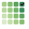
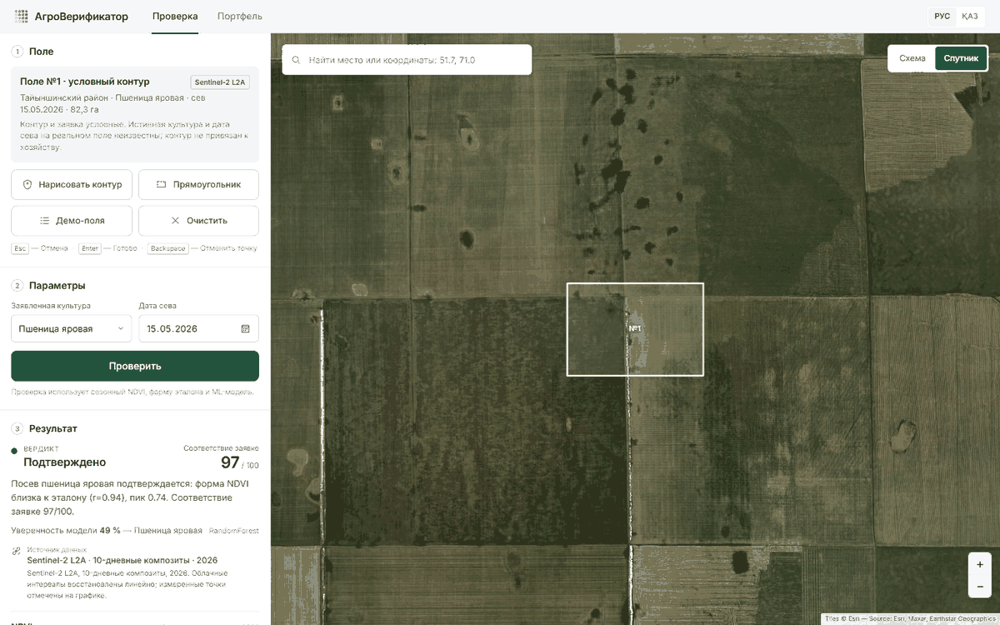
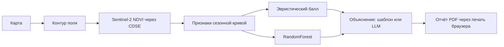
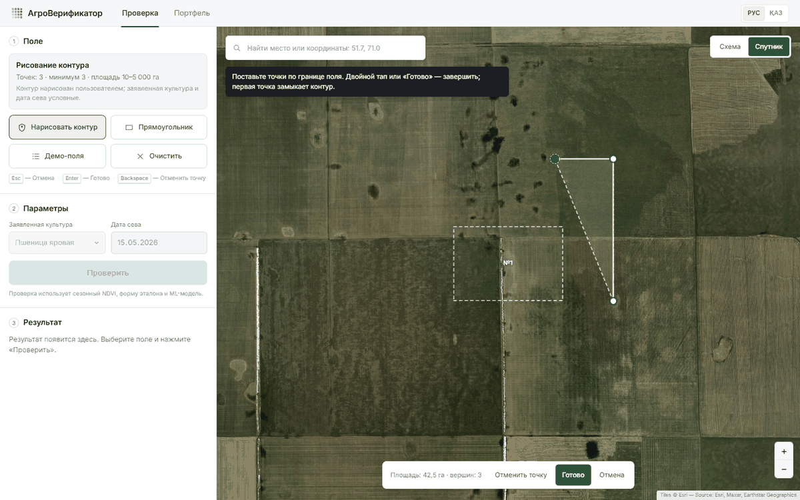
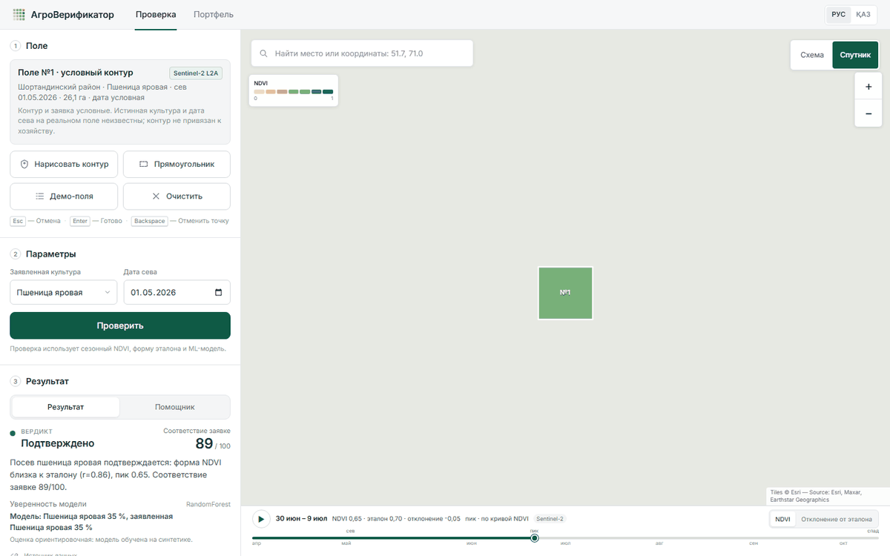
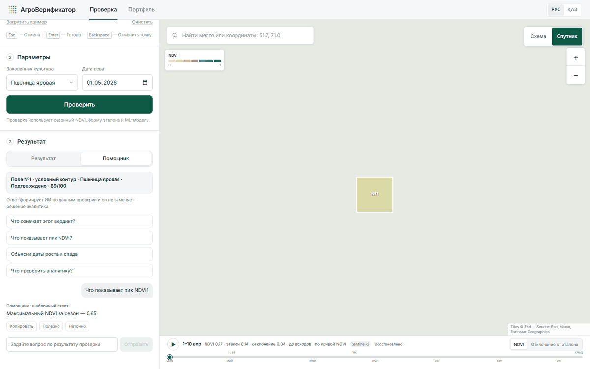
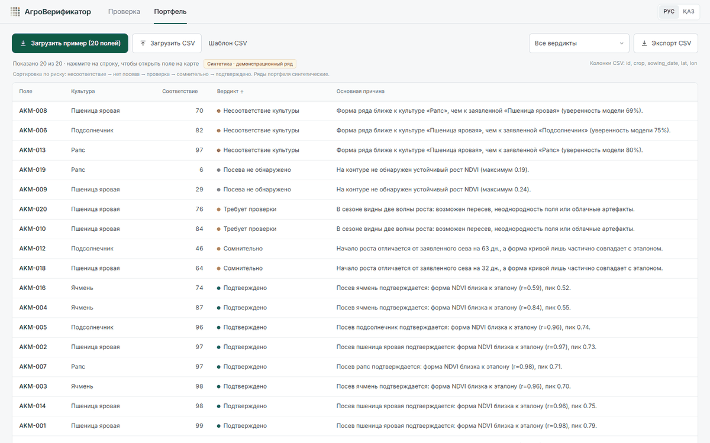
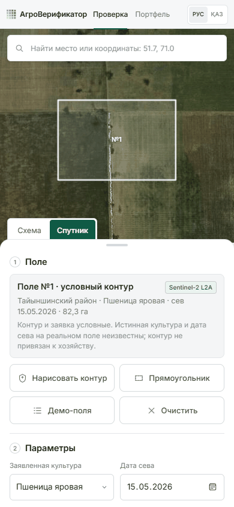

<div align="center">
  
  <h1>АгроВерификатор</h1>
  <p>Дистанционная проверка заявленного посева по сезонному ряду Sentinel-2.</p>
</div>


> **Публичная демоверсия не размещается. Приложение предназначено для локального или закрытого развёртывания.**



АгроВерификатор помогает аналитикам банков и МФО, лизинговых и страховых
компаний, а также акиматам дистанционно оценить, соответствует ли сезонная
динамика растительности заявленному посеву. Сервис сопоставляет контур поля и
показатели Sentinel-2 с эталонной кривой и показывает основания оценки.

## Как это работает



Числа, признаки и вердикт рассчитываются кодом по явным правилам. Модель и
необязательный LLM помогают интерпретировать результат, но не подменяют расчёт
и решение аналитика.

## Возможности

- Рисование, редактирование и очистка контура поля; свободное перемещение по
  карте и поиск координат или адреса.
- Схематическая и спутниковая подложки карты.
- Сезонный NDVI по Sentinel-2 L2A через CDSE для пользовательского контура;
  при недоступности сервиса используется отдельно обозначенный синтетический
  fallback.
- Временной ползунок с заливкой контура по NDVI, стадиями по кривой и
  сравнением с эталоном.
- Отдельные показатели «Соответствие заявке» и «Уверенность модели»,
  признаки сезонной динамики и погодный контекст.
- Объяснения на русском и казахском; чат-помощник с шаблонным режимом и
  необязательным подключением LM Studio или Groq. Чат использует показатели
  проверки, погодный контекст, сезонный NDVI-ряд и недавний диалог; на общие
  агрономические вопросы отвечает отдельно от выводов о конкретном поле.
- Пакетная проверка CSV и экспорт результатов в CSV.
- Печать результата в PDF средствами браузера.
- Примеры полей по ссылке «Загрузить пример» или параметру `?demo=1`.
- Калькулятор эффекта для сценарной оценки портфеля.

## Скриншоты

| Проверка поля | Рисование контура | Временной ползунок |
|---|---|---|
|  |  |  |
| Чат-помощник | Портфель | Мобильная версия |
|  |  |  |

## Данные и ограничения

- Для пользовательского контура запрашивается статистика Sentinel-2 L2A через
  Copernicus Data Space Ecosystem. Покрытие облаками, сезон, доступность CDSE и
  качество исходных снимков влияют на ряд.
- Предзагруженные демонстрационные поля используют сохранённые ряды; отдельные
  сценарии помечены как синтетические. При недоступности CDSE для пользовательского
  контура возможен синтетический fallback, который интерфейс маркирует.
- Культура и дата сева демонстрационного поля условные и не являются
  подтверждёнными сведениями о реальном хозяйстве.
- RandomForest обучен на синтетических сезонных кривых и не валидирован на
  реальных полях. Метрики модели приведены в
  [`backend/data/model_metrics.json`](backend/data/model_metrics.json) и
  относятся только к синтетической выборке.
- Результат — вспомогательная аналитическая оценка, а не юридическое
  доказательство факта посева и не автоматическое решение о выдаче финансирования.

## Быстрый старт

### Windows PowerShell

```powershell
py -3.12 -m venv .venv
.\.venv\Scripts\Activate.ps1
python -m pip install -r requirements.txt -r requirements-dev.txt
Copy-Item .env.example .env
# При необходимости заполните .env локально; не публикуйте его.
python -m uvicorn backend.main:app --host 127.0.0.1 --port 8000
```

Откройте `http://127.0.0.1:8000`. Для остановки нажмите `Ctrl+C` в окне
сервера.

### Linux и macOS

```bash
python3.12 -m venv .venv
source .venv/bin/activate
python -m pip install -r requirements.txt -r requirements-dev.txt
cp .env.example .env
# При необходимости заполните .env локально; не публикуйте его.
python -m uvicorn backend.main:app --host 127.0.0.1 --port 8000
```

### Переменные окружения

Все параметры интеграций необязательны для запуска демо. Значения задаются в
локальном `.env` или в настройках хостинга; файл `.env` не коммитьте.

| Переменная | Обязательность | Назначение |
|---|---|---|
| `CDSE_CLIENT_ID` | Необязательно | OAuth client ID Copernicus Data Space Ecosystem |
| `CDSE_CLIENT_SECRET` | Необязательно | OAuth client secret CDSE |
| `LLM_PROVIDER` | Необязательно | Не используется текущей конфигурацией; провайдер выбирается по ключу и URL |
| `LLM_API_KEY` | Необязательно | Ключ Groq; без ключа можно использовать локальную LM Studio |
| `LLM_MODEL` | Необязательно | ID модели; по умолчанию Qwen `qwen/qwen3.5-9b` для LM Studio и `llama-3.1-8b-instant` для Groq |
| `LLM_MODEL_KK` | Необязательно | Отдельная модель для казахского языка; по умолчанию используется `LLM_MODEL` |
| `LLM_BASE_URL` | Необязательно | Явный OpenAI-совместимый endpoint; при пустом URL Groq (`https://api.groq.com/openai/v1`) выбирается с ключом, иначе используется локальный LM Studio |
| `AGRO_DISABLE_NETWORK` | Необязательно | `1` отключает внешние запросы; демонстрационные данные остаются доступны |

Создайте OAuth-клиент в [Copernicus Data Space Ecosystem](https://dataspace.copernicus.eu/).
Для удалённого LLM получите ключ в [Groq Console](https://console.groq.com/keys).
Для локального режима установите [LM Studio](https://lmstudio.ai/) и запустите
OpenAI-совместимый сервер. Не вставляйте секреты в URL, README или исходный код.

## Деплой

Репозиторий содержит Dockerfile и рассчитан на Docker Web Service на Render,
включая Free-тариф. В панели Render задайте секреты окружения, а затем
сверьтесь с [DEPLOY.md](DEPLOY.md). Внешние спутниковые и погодные сервисы
подчиняются собственным ограничениям и доступности.

## Тесты

```bash
python -m pytest -q
```

Тесты работают в офлайн-режиме и используют моки для внешних LLM-запросов.
CI запускает ту же команду на Python 3.12.

## Структура проекта

```text
backend/                 FastAPI API, обработка данных, признаки и модели
  data/                  Эталонные профили, демонстрационные ряды и метрики
  scripts/               Скрипты подготовки данных
frontend/                Интерфейс приложения
  vendor/                Локальные сторонние JS/CSS и шрифты
tests/                   Pytest-тесты и Playwright-проверка интерфейса
docs/                    Документация, статус разработки и изображения
  screenshots/           Оптимизированные иллюстрации для README
Dockerfile               Контейнерный запуск
requirements.txt         Зависимости приложения
requirements-dev.txt     Зависимости тестирования и разработки
```

## Дорожная карта

- Рассмотреть Sentinel-1 для дополнительной оценки облачности и доступности наблюдений.
- Провести пилотную валидацию на реальных полях с подтверждённой культурой.
- Обучать классификатор на верифицированных данных, если они будут доступны.
- Добавить анализ нескольких сельскохозяйственных сезонов.

Сроки и гарантии выполнения не заявляются.

## Лицензия и благодарности

Код распространяется по лицензии [MIT](LICENSE). Условия сторонних компонентов,
данных и обязательные атрибуции собраны в
[THIRD_PARTY_NOTICES.md](THIRD_PARTY_NOTICES.md).

Правообладатель: **SwagMogTeam 19**.
